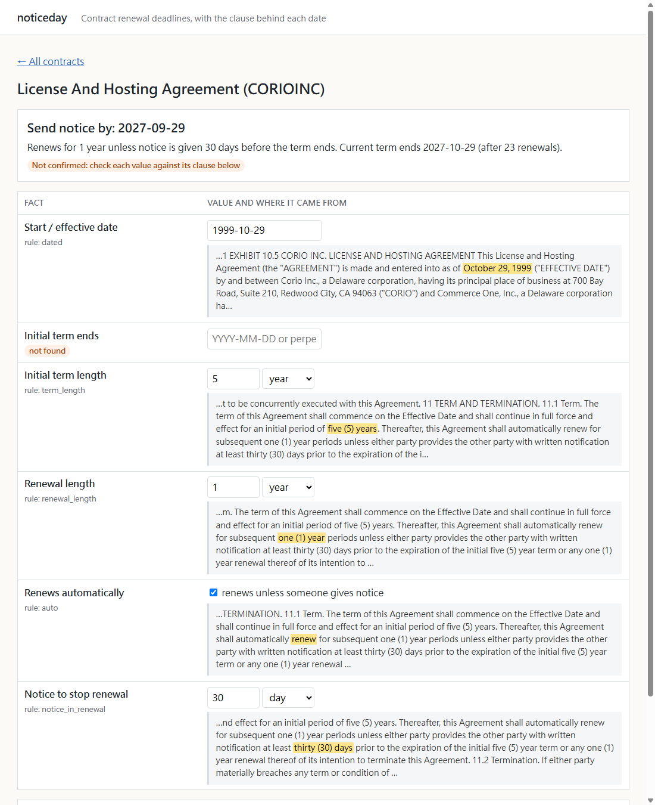
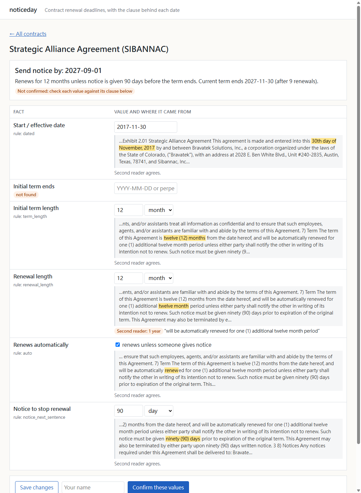

# noticeday

Finds the last day to cancel an auto-renewing contract and shows the clause each date came from.
A person confirms each value; only confirmed deadlines go on the calendar.
Measured on the 102-contract test split of CUAD, real SEC contracts annotated by lawyers.

## Results

CUAD test split, 102 contracts, rules as of commit `cca2f0c` (13 Nov 2026). "26 of 59" means
26 right out of the 59 contracts where the lawyers recorded a value.
**Wrong** is a value given and wrong (the dangerous case); **FA** (false alarm)
is a value where CUAD has none.

| method | initial expiration | renewal length | notice period | send-notice-by date |
|---|---|---|---|---|
| rules alone | 26 of 59 (8 wrong, 4 FA) | 17 of 23 (0 wrong, 2 FA) | 11 of 13 (0 wrong, 2 FA) | 3 of 10 (2 wrong) |
| rules + local model (union) | 37 of 59 (7 wrong, 10 FA) | 20 of 23 (0 wrong, 4 FA) | 12 of 13 (0 wrong, 9 FA) | 4 of 10 (3 wrong) |

Union = the rule value if there is one, otherwise the local model's value
(Qwen3-4B-Instruct-2507 on CPU) if its quote passes the evidence gate.
Rules take about 17 ms per contract (median over the 407 dev contracts; mean
24 ms); the model about 46 s on 8 CPU threads.
Full tables: `docs/results/test-*.md`.

- Renewal and notice periods are read well. The initial expiration date is
  the weak link, and "send notice by" needs both, so it is right in only 3
  or 4 of the 10 test contracts that have both. Ten contracts is a smoke
  test, not a ranking.
- In the first test run, all three wrong union deadlines came from a wrong
  start date, not from the arithmetic. That is why start dates were the
  focus of the latest dev work (below).
- **The latest dev gain did not carry over.** The start-date work below
  took dev start dates from 260 to 281 of 340 right, but on test the rules
  lost one correct expiration date (27 to 26 of 59) and the union lost one
  (38 to 37).
- **The test split is no longer untouched.** By the commit record it has
  been run seven times: once on frozen code (`66e258e`, from `bedc0d0`;
  table under [History](#history)), after five dev-only rule changes
  (`e837af4`, `91fd94c`, `353fcda`, `816e640`, `b3e954f`), and once for the
  table above (`41b1a30`). No rule was written from a test-split error, but
  the repeated runs make these figures less clean than a single held-out
  run. The dev split (407 contracts) is where the rules were tuned.
- After that last test run, a code review tightened two start-date rules
  (see below). Dev results did not change; the test split was not run
  again, so the table above is for `cca2f0c`.

## Quick start

```bash
uv venv && uv pip install -e . pytest httpx
pytest -q                                   # 40 tests (4 need '.[mcp]')
python scripts/seed_demo.py demo.db         # needs data/cuad (see "Reproduce"); or upload your own
NOTICEDAY_DB=demo.db uvicorn noticeday.app:app --port 8830
# second reader: add NOTICEDAY_MODEL=<Qwen3-4B-Instruct-2507 folder> and pip install -e '.[model]'; needs ~8 GB RAM
```

CI (`.github/workflows/ci.yml`) runs the fast tests on Python 3.12 without
the model dependencies: `pytest -q -m "not model"`. Tests that need model
weights must carry `@pytest.mark.model`.

## Ask Claude about your deadlines (MCP server)

`noticeday/mcp_server.py` exposes the contract database to Claude Desktop or
Claude Code over MCP. Three read-only tools:

- `list_deadlines(within_days, confirmed_only)`: what is due, soonest first.
- `get_contract(contract_id)`: the schedule, each value, and the contract words
  it was read from.
- `search_contracts(query)`: find a contract by name or wording.

There are no write tools on purpose. An assistant cannot confirm or edit a
value; every answer says whether a person has confirmed it, and the server's
instructions tell the assistant to say so. Confirming stays in the web app.

```bash
uv pip install -e '.[mcp]'
claude mcp add noticeday -e NOTICEDAY_DB=$PWD/demo.db -- $PWD/.venv/bin/python -m noticeday.mcp_server
```

Then ask "which contracts need notice in the next six months?". Tested with
the MCP Python SDK client in-process (`tests/test_mcp.py`) and over stdio on
the demo database.

## Limits

- **No real customer.** CUAD contracts are large-company SEC exhibits
  (licences, supply, distribution), not a café's waste-collection or
  photocopier lease. Small-business contracts are shorter and more often
  pre-printed forms. Whether accuracy holds on those is unmeasured.
- **The test split is 102 contracts**, and only a minority have a renewal
  or notice period at all. The per-field counts are small and the intervals
  wide; the tables give raw counts so they can be read that way.
- **Date convention.** CUAD (and this tool) take "two years from 14 Feb
  2019" to end on 14 Feb 2021, and notice "60 days before" to be due 60 days
  earlier. Some contracts define it differently ("the day before the
  anniversary", business days). The review page shows the clause so a
  person can check it.
- **Scanned PDFs** without a text layer are rejected; there is no OCR step.
- **No login, no multi-user accounts, no email reminders.** The calendar
  file is the reminder channel. These would come before any real pilot.
- Amendments that change the term are not linked to the original contract.
- **Option deadlines are rules-only and unmeasured.** "Notify us six months
  before the end of the term if you want to extend" is a deadline too. Since
  milestone 8, the rules extract it when renewal is not automatic, and the
  dashboard shows "Exercise renewal option by". CUAD has no label for it. By
  my own reading of the 9 dev-split hits: 6 right, 2 borderline (a
  franchisor's notice; a renewal the parties must both agree to), 1 wrong.
  That is an inspection, not a measurement.
- Evergreen month-to-month continuations ("thereafter continues on a month
  to month basis until terminated") are now read as a 1-month renewal with
  their notice period (since 13 Nov), but the scheduler still treats them
  like any renewal; a contract that runs "until terminated" with no renewal
  wording is shown as "no fixed end".

## What it does

**The business problem.** Small businesses sign service contracts (waste
collection, equipment leases, software, cleaning, security monitoring) that
renew by themselves unless someone sends notice 30 to 180 days before the
term ends. Nobody tracks the notice date, the window closes, and the business
is locked in for another year. The contract says when. The hard part is
reading it correctly and having the date in front of someone in time.

**What it does.**

1. Upload a contract (PDF with a text layer, or text).
2. It reads the start date, initial term or end date, renewal length, whether
   renewal is automatic, and the notice period. Each value is shown next to
   the highlighted words it came from.
3. A person checks each value, edits it if needed, and confirms with their
   name. Editing after confirming clears the confirmation.
4. The dashboard rolls auto-renewing terms forward to the next notice
   deadline that is still open, and sorts contracts by it. It stops at the
   number of renewals the contract allows ("one (1) additional twelve month
   period").
5. `calendar.ics` holds only confirmed deadlines, each with a reminder
   14 days before.
6. For a confirmed auto-renewing contract, it drafts a non-renewal notice
   letter with the notice clause underneath. It never sends anything.
7. Where renewal is at one party's option, the date by which that party
   must give notice to renew ("Exercise renewal option by").
8. Optional **second reader**: with `NOTICEDAY_MODEL` set, a local model
   reads each upload in the background, about a minute per contract. Each
   value is marked "agrees" or shows the model's different value with its
   quote. Values the model could not back with a quote are listed as such.



Second reader on the same page (before the renewal-limit and duration-comparison fixes it led to):



## Extraction methods

- **rules** (`noticeday/extract.py`): regular expressions for dates,
  durations and number words, plus sentence scoring. They skip cure periods
  ("within 30 days after notice of breach"), survival clauses ("for five
  years after termination") and extensions that need both parties to agree.
- **model** (`noticeday/model.py`): Qwen3-4B-Instruct-2507 on CPU (about 47 s
  per contract, 8 threads, no GPU, no API). It reads the preamble plus the
  highest-scoring term sentences and answers in JSON, with a verbatim quote
  for each value. **Evidence gate:** a value is kept only if its quote is in
  the contract *and* the value can be parsed back out of the quote. On dev
  the gate dropped values the model had computed or restated: a term derived
  from an end date, "two (2) months" restated as 60 days, "perpetual" backed
  by an unrelated sentence. A dropped value is shown as "not found", so a
  person fills it in.
- **union**: the rule value if there is one, otherwise the gated model value.
- **agree**: a value only where rules and the gated model give the same one.

The app always runs the rules (instant). The model runs as the optional
second reader in the app, or in batch with `scripts/run_model.py`.

**What the second reader caught on its first live run.** On a dev contract
both readers agreed on everything except how to write the renewal ("12
months" vs "1 year"; durations are now compared as durations). Its quote,
"automatically renewed for **one (1) additional** twelve month period",
showed a gap in the scheduler: it rolled the contract forward nine times to
a 2027 deadline, but the contract allows one renewal and ended in 2019.
Renewal limits are now extracted and respected. On the dev split the rules
find 8 limits, all correct on inspection, but only 2 of the 6 renewal
answers where the lawyers wrote a count. A missed limit is the most
dangerous error left: it shows a deadline for a contract that has already
ended. It is a reason the review step stays.

## How it is measured

[CUAD](https://github.com/TheAtticusProject/cuad) is 510 real commercial
contracts from SEC filings, annotated by lawyers (CC BY 4.0). Its
`master_clauses.csv` ([Zenodo](https://zenodo.org/records/4595826)) gives
normalized answers: effective date, expiration date, renewal term and notice
period. That makes the end-to-end "send notice by" date checkable:
expiration minus notice period, by CUAD's own convention.

### Start dates (13 Nov 2026, dev split only)

Start dates were the main error source. Scored against CUAD's effective
date, or its agreement date when the effective-date field is empty (partial dates
like "[]/[]/2013" are not scored), the rules had 260 of 340 dev start dates
right, 39 wrong and 41 not found. (An earlier count in this README, 261/341,
used a slightly different definition.) The 39 wrong ones, grouped by cause:

| cause | wrong | fixed |
|---|---|---|
| the term clause sets the start ("The term ... shall commence on December 1, 2001") but the signing date was taken | 10 | 10 |
| the date is labelled after it (`as of April 14, 2014 (the "Effective Date")`) but a later "effective" date of another document won | 7 (+1 not found) | 7 (+1) |
| a bare "effective" about another event or document ("Commission will decrease by .5% effective 10/1/99") | 5 | 0 |
| the date of another agreement between other parties ("... Agreement, dated as of November 28, 2013, by and between FSL and TPH") | 5 | 3 |
| signature-block dates, where the contract starts at the last signature | 5 | 2 |
| other (CUAD answer not in the text, an effective date defined by a time of day or an event, a launch date, a broken "26t h day") | 7 | 0 |

The "bare effective" group was not fixed: requiring such dates, past the
opening part of the contract, to mention "this Agreement" lost one correct
start date and fixed none, so that change was dropped.

Each fix has a test in `tests/test_extract.py` and was kept only because
dev expiration and deadline results did not get worse.

A code review afterwards found two of the new rules too loose: the
commencement rule also took "The term of each Statement of Work shall
commence on ..." and "the Reseller ... shall start on ...", and the
signature rule chained any run of "Date:" dates. Both now require the
contract (or its term) as the subject, or a signature block ("/s/", "By:")
and at most two dates. Dev start dates, expiration and deadlines are
unchanged by this; tests cover the review's cases.

| dev split, rules | before | after |
|---|---|---|
| start date | 260 of 340 right, 39 wrong, 41 not found | 281 of 340 right, 17 wrong, 42 not found |
| initial expiration | 132 of 247, 22 wrong, 18 FA | 136 of 247, 17 wrong, 18 FA |
| send-notice-by date | 30 of 68 right, 5 wrong | 31 of 68 right, 5 wrong |

On the test split (one run at `cca2f0c`, before the review fixes; raw
output in `docs/results/test-start-dates.md`): rule start dates
65 of 87 right, 14 wrong, 8 not found. Rules expiration went from 27 of 59
(7 wrong) to 26 of 59 (8 wrong); union from 38 (6 wrong) to 37 (7 wrong).
Renewal, notice and the send-notice-by date did not change. So the dev gain
did not carry over to test; the change in the test errors was not
investigated, to keep the test split from steering the rules.

### Reproduce

Reproduce the measurements (downloads about 125 MB of CUAD data):

```bash
mkdir -p data/raw && cd data/raw
curl -L -o cuad.zip https://github.com/TheAtticusProject/cuad/raw/main/data.zip && unzip cuad.zip -d cuad
curl -L -o full.zip "https://zenodo.org/records/4595826/files/CUAD_v1.zip?download=1" && unzip full.zip 'CUAD_v1/master_clauses.csv'
cd ../.. && python scripts/prepare_cuad.py
python scripts/evaluate.py --split test --method rules
uv pip install -e '.[model]'                # torch + transformers, CPU is enough
NOTICEDAY_MODEL=<folder with Qwen3-4B-Instruct-2507 weights> python scripts/run_model.py --split test
for m in model_raw model union agree; do python scripts/evaluate.py --split test --method $m; done
```

Start dates alone: `python scripts/score_start_dates.py --split dev`.

## History

### First test run on frozen code (`bedc0d0`)

Rules were developed on the 407-contract dev split. The model prompt and
the evidence gate were checked on 30 dev contracts. Everything was
committed (`bedc0d0`) before the 102-contract test split was first run.

Accuracy is over contracts where the lawyers recorded a value; counts in
brackets. **Wrong** means a value was given and it was wrong (the dangerous
case). **False alarm** means a value where CUAD has none.

| method | expiration | renewal length | notice period | send-notice-by date |
|---|---|---|---|---|
| rules | 44.1% (26/59), 9 wrong, 4 false alarms | 73.9% (17/23), 0 wrong, 3 FA | 84.6% (11/13), 0 wrong, 2 FA | 2/10, 2 wrong |
| model, no gate | 61.0% (36/59), 7 wrong, 11 FA | 91.3% (21/23), 0 wrong, 2 FA | 84.6% (11/13), 0 wrong, 12 FA | 4/10, 3 wrong |
| model, gated | 44.1% (26/59), 5 wrong, 9 FA | 82.6% (19/23), 0 wrong, 2 FA | 84.6% (11/13), 0 wrong, 9 FA | 1/10, 3 wrong |
| union (rules, else gated model) | **62.7% (37/59)**, 8 wrong, 10 FA | 87.0% (20/23), 0 wrong, 5 FA | **92.3% (12/13)**, 0 wrong, 9 FA | 4/10, 3 wrong |
| agree (both give the same value) | 27.1% (16/59), 2 wrong, 3 FA | 69.6% (16/23), 0 wrong, 0 FA | 76.9% (10/13), 0 wrong, 2 FA | 0/10, 1 wrong |

Full tables: `docs/results/test-*.md`. What the numbers say:

- **Renewal and notice periods are found well; the expiration date is the
  weak link.** Even the best method gets the initial end date right in only
  63% of contracts, and "send notice by" needs both. Only 10 test contracts
  have both an expiration date and a notice period, so the end-to-end column
  is too small to rank methods. Treat it as a smoke test, not a result.
- **Wrong deadlines come from the start date**, not the arithmetic: in all
  three wrong union deadlines the start date was a few days or years off
  (the signing date or a recital date instead of the effective date).
- **The evidence gate cut wrong expiration dates from 7 to 5 but also
  dropped 10 correct ones.** Most dropped ones were correct values the model
  computed (a term from an end date), which the gate refuses by design.
  For renewal and notice it cost 2 correct renewals and removed 3 notice
  false alarms. It is a precision tool, and it costs recall.
- **When rules and model agree, they are rarely wrong**: 2 wrong
  expirations out of 21 agreed values, and no wrong renewal or notice
  values. But they agree on few contracts. That fits a review queue:
  agreement marks a value as lower risk, and everything else goes to a
  person. It does not justify skipping the person.
- **Most of the model's notice "false alarms" are real deadlines CUAD does
  not count**: notice to *exercise an option to extend* ("must notify
  Airspan at least six (6) months prior to the end of the Initial Term"),
  or to negotiate an extension. A business would want those on the calendar
  too, so the app should treat them as a second kind of deadline rather
  than discard them. Some are true errors (termination-for-convenience
  notice).
- Speed: the 4B model took 46 s per contract on 8 CPU threads (79 minutes
  for 102 contracts); the rules took about 10 ms at the time.

### Dev-only changes after the first test run

The table above is the one run on the frozen code. Afterwards, working on
the dev split only, I fixed why the rules missed 104 dev expiration dates:

- **The survival filter was too broad.** Any "after", "following" or
  "thereafter" next to a duration counted as a survival clause, so "three (3)
  years after the Effective Date" and "ten (10) years thereafter" were thrown
  away. Now it only counts when the words refer to termination or expiry, or
  follow "during the term".
- **Terms that count from an event** ("ten (10) years after the First
  Commercial Sale") are left for a person, because they have no fixed end
  date.
- **More ways to state the end:** "take effect", "come into force",
  "up to and including", "until the earlier of (i)", "TERM: <date> to <date>".

| split | method | expiration before | expiration after | deadline before | deadline after |
|---|---|---|---|---|---|
| dev | rules | 45.7% (113/247), 30 wrong, 22 FA | 53.4% (132/247), 22 wrong, 18 FA | 24 right, 8 wrong | 30 right, 5 wrong |
| test | rules | 44.1% (26/59), 9 wrong, 4 FA | 45.8% (27/59), 7 wrong, 4 FA | 2/10, 2 wrong | 3/10, 2 wrong |
| test | union | 62.7% (37/59), 8 wrong, 10 FA | 64.4% (38/59), 6 wrong, 10 FA | 4/10, 3 wrong | 4/10, 3 wrong |

**Renewal wording (same day).** A second pass on dev added renewal phrasings
the rules missed: "renewing annually", "renewed tacitly every year",
"extend automatically for monthly periods", "half a year", Roman numerals
("one (I) year"), and "successive terms of the same duration" (the renewal
equals the initial term). Dev renewal went from 74.2% (92/124, 4 wrong) to
83.9% (104/124, 3 wrong); dev notice from 57 to 59 correct. On test it
changed nothing that counts: renewal stays 17/23 (one fewer false alarm).
Two dev deadlines moved from "needs facts" to wrong: the renewal is now
found, and the start date was a few days off, which is the known weak point.

**Start dates (same day).** Wrong start dates cause most wrong deadlines.
The rules now skip SEC filing footers ("Source: ACME INC., 10-K,
3/21/2019") and dates that belong to another document ("the EPC Agreement
dated September 30, 2009 (the "EPC Agreement")", "... dated ... entitled").
On dev, start dates right stay 261/341; wrong ones fall from 57 to 39 (they
become "not found", so a person enters them). Dev expiration wrong 28 -> 23,
false alarms 21 -> 18, deadline wrong 8 -> 6, correct unchanged. On test,
rules expiration stays 27/59 with 7 wrong; union goes from 7 wrong to 6.

**Notice periods (same day).** For open-ended continuations ("continue on a
month to month basis until terminated upon thirty (30) days prior written
notice") the notice period is how the contract is stopped, so it is now
captured; and "within sixty (60) days prior to the expiration" is no longer
mistaken for a cure period. Dev notice 59 -> 62 correct (no new wrong
values or false alarms); dev deadline 28 right / 6 wrong -> 29 / 7. Test
unchanged (11/13 rules, 12/13 union).

**Lengths vs notice (same day).** A duration followed by "term(s)" or
"period(s)" ("successive 5-year terms") is no longer taken as the notice
period, and one followed by "renewal" ("one year renewal term") is no longer
taken as the initial term. Dev notice 62 -> 63 correct and 1 -> 0 wrong;
dev deadline 29 right / 7 wrong -> 30 / 5. Test unchanged.

## Licence

Code: MIT (`LICENSE`). Not bundled, downloaded by the user:
[CUAD](https://github.com/TheAtticusProject/cuad) contracts and answers are
CC BY 4.0 (The Atticus Project); the screenshots in `docs/` show CUAD
contract text. The optional model, Qwen3-4B-Instruct-2507, is Apache 2.0.
